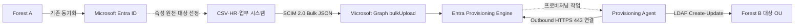

# Entra ID에서 온프레미스 AD로 API 기반 사용자 프로비저닝

Forest A에서 Microsoft Entra ID로 동기화된 계정을 별도의 Forest B로 프로비저닝하는 방안을 정리합니다. Entra ID가 프로비저닝 허브 역할을 하며, 대상 Forest B에는 Microsoft Entra Provisioning Agent를 설치하고 SCIM 스키마로 구성한 사용자 데이터를 Microsoft Graph의 `/bulkUpload` API에 전달합니다.

> Microsoft 관리 화면에서는 이 기능을 **API-driven inbound provisioning to on-premises Active Directory**라고 부릅니다. 여기서 `inbound`는 API가 데이터를 Entra 프로비저닝 서비스로 수신한다는 관점입니다. 실제 계정 생성 방향은 **Entra 프로비저닝 서비스 → 대상 온프레미스 AD**입니다.

## 결론

Forest A의 사용자 데이터를 Forest B에 보내려면 원본 데이터를 읽어 SCIM 요청으로 전송할 호출기와 대상 AD에서 계정을 처리할 에이전트가 필요합니다. 다음 구성 요소를 준비하세요.

- API-driven provisioning용 Enterprise Application
- `SynchronizationData-User.Upload` 애플리케이션 권한을 가진 호출용 App Registration
- Forest B에 연결된 Microsoft Entra Provisioning Agent
- 사용자 데이터를 SCIM 2.0 Bulk JSON으로 변환하고 `/bulkUpload` 엔드포인트를 호출하는 처리 로직
- 대상 OU, 속성 매핑, 중복 판정 및 프로비저닝 감사 로그 운영 절차

## 전체 아키텍처



에이전트가 클라우드 서비스로 HTTPS 443 연결을 시작하고, 그 연결을 통해 작업을 받습니다. 도식의 점선은 작업 흐름입니다. 인증서 폐기 목록 확인용 HTTP 80 등 추가 통신 조건도 [공식 방화벽 요구사항](https://learn.microsoft.com/en-us/entra/identity/hybrid/cloud-sync/how-to-prerequisites#firewall-and-proxy-requirements)에서 확인하세요.

API 호출 서버가 Forest A의 디렉터리를 직접 조회할 수도 있고, 별도 CSV·HR 시스템·통합 플랫폼에서 대상 사용자 데이터를 제공할 수도 있습니다. 어떤 원천을 선택하든 API에는 필요한 속성을 SCIM 스키마로 명시적으로 전달해야 합니다.

## 사전 요구사항

| 구성 요소 | 요구사항 |
|---|---|
| 라이선스 | Microsoft Entra ID P1, P2 또는 ID Governance. 대상 사용자에게 필요한 권한과 일일 API 한도를 확인 |
| 관리자 역할 | 앱 구성에는 Application Administrator, 에이전트 등록에는 Hybrid Identity Administrator, 대상 AD 구성에는 필요한 도메인 권한 |
| 네트워크 | Provisioning Agent가 Microsoft 서비스로 HTTPS 443 아웃바운드 통신 가능 |
| 대상 AD | Forest B의 쓰기 가능한 대상 OU와 계정 생성 권한 |
| 호출 앱 | Client Credentials 방식 인증과 관리자 동의 |
| API 권한 | Microsoft Graph 애플리케이션 권한 `SynchronizationData-User.Upload` |
| 입력 데이터 | 고유 식별자, UPN, 이름, 표시 이름 등 속성 매핑에 필요한 값 |

운영 배포 전에는 [Microsoft Entra Cloud Sync 사전 요구사항](https://learn.microsoft.com/entra/identity/hybrid/cloud-sync/how-to-prerequisites)과 API 기반 프로비저닝의 현재 지원 조건을 확인합니다.

## 1. Provisioning Agent 설치

1. Forest B에 조인된 멤버 서버에 Microsoft Entra Provisioning Agent를 설치합니다. 도메인 컨트롤러에 설치할 필요는 없습니다.
2. Hybrid Identity Administrator 이상의 역할을 가진 계정으로 Entra ID에 인증합니다.
3. 대상 AD에 접근할 gMSA를 구성합니다. 자동 생성 절차에는 필요한 AD 권한이 있어야 합니다.
4. Entra 관리 센터에서 에이전트 상태가 활성으로 보고되는지 확인합니다.
5. 대상 Forest와 계정을 생성할 OU의 Distinguished Name을 기록합니다.

고가용성이 필요하면 단일 에이전트에 의존하지 않도록 동일 구성의 추가 에이전트 배치를 검토합니다.

## 2. API 기반 Enterprise Application 구성

Entra 관리 센터에서 다음 경로로 이동합니다.

```text
Entra ID > Enterprise apps > New application
```

1. `API-driven provisioning to on-premises Active Directory`를 검색하여 생성합니다.
2. 애플리케이션의 **Provisioning** 메뉴에서 모드를 자동으로 설정합니다.
3. Forest B의 도메인을 선택하고 대상 OU DN을 입력한 뒤 연결을 테스트하고 저장합니다.
4. **Settings**에 유효한 **Notification Email**을 입력하고 저장합니다. 이 값이 비어 있으면 실행을 시작할 때 프로비저닝이 격리 상태로 들어갑니다.
5. 속성 매핑과 일치 규칙을 검토합니다.
6. 설정을 저장한 뒤 **Start provisioning**으로 API 요청을 받을 수 있도록 작업을 시작합니다.

[Microsoft의 앱 구성 절차](https://learn.microsoft.com/en-us/entra/identity/app-provisioning/inbound-provisioning-api-configure-app#configure-api-driven-inbound-provisioning-to-on-premises-ad)에서 관리자 역할, 알림 이메일과 시작 조건을 확인할 수 있습니다.

**Restart provisioning은 재시도 버튼이 아닙니다.** 앱 구성 가이드는 처리 대기 요청을 지운다고 설명합니다. [공식 FAQ](https://learn.microsoft.com/en-us/entra/identity/app-provisioning/inbound-provisioning-api-faqs#how-does-restart-provisioning-work)는 실행 중인 주기는 중단하지 않고, 작업이 실행 중이 아닐 때 재시작하면 이전에 올린 데이터를 삭제한다고 구분합니다. 진행 중인 처리를 즉시 취소하거나 실패 요청만 다시 실행하는 기능으로 사용하지 마세요. 재시작 전에 작업 상태와 요청 재전송 가능 여부를 확인하세요. 이 API 기반 앱에서는 **Provision on demand**를 지원하지 않으므로 API 전송 결과와 프로비저닝 로그로 처리 상태를 확인합니다.

### Cloud Sync 사용자 프로비저닝과의 차이

Cloud Sync에는 **Entra ID → AD 사용자 프로비저닝 미리 보기**도 있습니다. 클라우드에서 생성한 사용자, 관리 원본(SOA)을 클라우드로 전환한 사용자, 범위에 포함한 B2B 게스트를 대상으로 합니다. 반면 AD가 관리 원본인 동기화 사용자는 이 방향으로 프로비저닝하지 않습니다. 따라서 Forest A에서 동기화한 사용자를 그대로 Forest B에 보내는 API 설계와 같은 기능으로 보면 안 됩니다. [공식 처리 규칙과 SOA별 지원 범위](https://learn.microsoft.com/en-us/entra/identity/hybrid/cloud-sync/how-provisioning-to-active-directory-works#user-soa-scenarios)를 먼저 확인하세요.

이 Cloud Sync 방식의 클라우드 관리 사용자에게는 AD 암호와 암호 쓰기 저장을 제공하지 않습니다. Kerberos 기반 앱의 암호 없는 인증을 전제로 하며, LDAP 암호 인증을 대신할 수 없습니다. 사용자 프로비저닝은 미리 보기이고 그룹 프로비저닝은 정식 제공입니다. [기능 개요와 제한 사항](https://learn.microsoft.com/en-us/entra/identity/hybrid/cloud-sync/overview-provision-entra-id-to-active-directory)을 확인해 대상 사용자의 관리 원본과 앱 인증 방식을 기준으로 선택하세요.

외부 시스템이 사용자 데이터를 직접 공급하는 API 방식에서는 이 문서의 애플리케이션 구성과 SCIM 호출 단계가 필요합니다.

## 3. API 호출용 App Registration

별도의 App Registration을 만들고 Microsoft Graph의 다음 **Application 접근 권한**을 할당합니다.

```text
SynchronizationData-User.Upload
```

위 예시는 `SynchronizationData-User.Upload`를 사용합니다. [현재 API 권한 표](https://learn.microsoft.com/en-us/graph/api/synchronization-synchronizationjob-post-bulkupload?view=graph-rest-1.0#permissions)는 애플리케이션의 최소 권한으로 `SynchronizationData-User.Upload.OwnedBy`를 안내하므로, 적용 조건과 접근할 프로비저닝 앱의 범위를 확인해 필요한 권한만 부여하세요.

관리자 동의를 완료한 뒤 다음 값을 수집합니다.

- Tenant ID
- Client ID
- Client Secret 또는 인증서
- API-driven Enterprise Application의 Service Principal ID
- Provisioning Job ID

운영 환경에서는 Client Secret을 스크립트나 CSV에 평문으로 저장하지 말고 인증서 자격 증명, Azure Key Vault 또는 조직의 비밀 관리 체계를 사용합니다.

## 4. bulkUpload 엔드포인트

Enterprise Application의 프로비저닝 개요에서 API 엔드포인트를 확인합니다.

```text
https://graph.microsoft.com/v1.0/servicePrincipals/{servicePrincipalId}/synchronization/jobs/{jobId}/bulkUpload
```

**이 엔드포인트는 표준 SCIM 서버가 아닙니다.** SCIM 스키마를 요청 본문에 사용하지만 HTTP `POST`만 받으며 `GET`·`PUT`·`PATCH`는 지원하지 않습니다. 사용자 수정도 `POST`로 보내고, 프로비저닝 서비스가 매핑과 일치 규칙에 따라 생성·수정·활성화·비활성화를 결정합니다. [API 동작과 표준 SCIM의 차이](https://learn.microsoft.com/en-us/entra/identity/app-provisioning/inbound-provisioning-api-faqs#is-the-inbound-provisioning-bulkupload-api-a-standard-scim-endpoint)를 참고하세요.

요청 헤더는 OAuth 2.0 Client Credentials로 받은 Microsoft Graph 액세스 토큰과 SCIM 콘텐츠 형식을 사용합니다.

```http
Authorization: Bearer <access-token>
Content-Type: application/scim+json
```

## 5. 입력 데이터와 SCIM 매핑

입력 파일은 구현에 따라 CSV, HR 데이터 또는 API 응답이 될 수 있습니다. 예시는 다음과 같습니다.

```csv
UserPrincipalName,EmployeeId,DisplayName,FirstName,LastName,Department
test10@example.com,EMP-10010,Test User 10,Test,User 10,IT Infrastructure
```

SCIM Bulk 요청의 각 작업은 `/Users` 경로로 전송합니다. 표준 Enterprise User 확장에서 사번은 `employeeNumber`입니다. 대상 AD의 `employeeID`에 넣을지는 프로비저닝 속성 매핑에서 정하세요. [Graph bulkUpload의 표준 스키마 예제](https://learn.microsoft.com/en-us/graph/api/synchronization-synchronizationjob-post-bulkupload?view=graph-rest-1.0#example-1-bulk-upload-using-scim-core-user-and-enterprise-user-schema)를 참고합니다.

```json
{
  "schemas": ["urn:ietf:params:scim:api:messages:2.0:BulkRequest"],
  "Operations": [
    {
      "method": "POST",
      "bulkId": "<unique-guid>",
      "path": "/Users",
      "data": {
        "schemas": [
          "urn:ietf:params:scim:schemas:core:2.0:User",
          "urn:ietf:params:scim:schemas:extension:enterprise:2.0:User"
        ],
        "userName": "test10@example.com",
        "externalId": "EMP-10010",
        "displayName": "Test User 10",
        "active": true,
        "name": {
          "familyName": "User 10",
          "givenName": "Test"
        },
        "urn:ietf:params:scim:schemas:extension:enterprise:2.0:User": {
          "employeeNumber": "EMP-10010",
          "department": "IT Infrastructure"
        }
      }
    }
  ]
}
```

예시는 구조를 설명하기 위한 일부 속성만 보여줍니다. 실제 요청에는 전체·증분 동기화 모두 해당 사용자에 대해 매핑한 전체 속성 값을 포함하세요. 빈 값 지우기 기능(미리 보기)을 켰다면 `null`·빈 문자열뿐 아니라 해당 매핑 속성의 누락도 기존 값을 지울 수 있습니다. [요청 데이터와 비동기 처리 조건](https://learn.microsoft.com/en-us/entra/identity/app-provisioning/inbound-provisioning-api-concepts)을 확인하세요.

`Operations` 배열에는 한 요청당 **사용자 작업을 최대 50개**까지 넣을 수 있습니다. 이는 [Microsoft Graph bulkUpload 제한](https://learn.microsoft.com/en-us/graph/api/synchronization-synchronizationjob-post-bulkupload?view=graph-rest-1.0)에 명시된 값입니다.

호출 횟수는 요청 크기와 별도로 관리하세요.

- [API 기반 프로비저닝 개요](https://learn.microsoft.com/en-us/entra/identity/app-provisioning/inbound-provisioning-api-concepts)는 **5초 동안 최대 40회**, **테넌트 전체의 24시간 한도는 P1/P2 2,000회·ID Governance 6,000회**로 안내합니다.
- Graph API 참조에는 속도가 **초당 40회**로 적혀 있어 개요 문서와 단위가 다릅니다. 초기에는 더 낮은 한도인 5초당 40회를 넘지 않도록 호출하고, 실제 `429` 응답에 맞춰 조정하세요. 요청량은 24시간 한도도 함께 고려해야 합니다.
- 일부 작업이 실패하면 결과 로그에서 실패한 레코드를 확인해 다시 전송하세요. 같은 요청을 반복해도 중복 계정이 생기지 않도록 매칭 속성을 정하고, 재시도에는 대기 시간을 두세요.

## 6. PowerShell 호출 구조

아래 코드는 핵심 호출 흐름을 보여주는 축약 예시입니다. `$scimPayload`에는 앞 절의 SCIM 구조를 PowerShell 객체로 준비하고, 비밀 값은 환경변수 또는 비밀 저장소에서 가져옵니다. 한글 이름과 부서명이 전송 중 바뀌지 않도록 요청의 `charset=utf-8`을 명시합니다. [Invoke-RestMethod의 ContentType과 인코딩](https://learn.microsoft.com/en-us/powershell/module/microsoft.powershell.utility/invoke-restmethod?view=powershell-5.1#-contenttype)을 참고하세요.

```powershell
$tenantId = '<Tenant ID>'
$clientId = '<Client ID>'
$clientSecret = $env:ENTRA_PROVISIONING_CLIENT_SECRET
$servicePrincipalId = '<Service Principal ID>'
$jobId = '<Provisioning Job ID>'

$endpoint = "https://graph.microsoft.com/v1.0/servicePrincipals/$servicePrincipalId/synchronization/jobs/$jobId/bulkUpload"

$tokenBody = @{
    grant_type    = 'client_credentials'
    scope         = 'https://graph.microsoft.com/.default'
    client_id     = $clientId
    client_secret = $clientSecret
}

$token = Invoke-RestMethod `
    -Uri "https://login.microsoftonline.com/$tenantId/oauth2/v2.0/token" `
    -Method Post `
    -Body $tokenBody

$headers = @{
    Authorization = "Bearer $($token.access_token)"
}

Invoke-RestMethod `
    -Uri $endpoint `
    -Method Post `
    -Headers $headers `
    -ContentType 'application/scim+json; charset=utf-8' `
    -Body ($scimPayload | ConvertTo-Json -Depth 10)
```

운영용 호출기는 다음 기능을 추가해야 합니다.

- 입력 스키마와 필수 속성 검증
- 50개 이하 배치 분할
- HTTP `202 Accepted`는 접수 성공으로 기록하고 계정 생성 완료와 구분
- 프로비저닝 로그 API에서 사용자별 처리·실패 결과 확인. 로그 조회 권한은 아래의 API별 안내를 함께 확인합니다.
- 429 및 일시적 오류에 대한 지수 백오프 재시도
- 동일 사용자의 중복 생성 방지를 위한 안정적인 `externalId`
- 실패 배치 재처리 및 감사 가능한 상관관계 ID

- 비밀 마스킹과 최소 권한 실행 계정

로그 권한은 공식 문서의 표기가 다릅니다. [API 기반 프로비저닝 권한 가이드](https://learn.microsoft.com/en-us/entra/identity/app-provisioning/inbound-provisioning-api-grant-access)는 `ProvisioningLog.Read.All`을 안내하지만, [GET /auditLogs/provisioning 참조](https://learn.microsoft.com/en-us/graph/api/provisioningobjectsummary-list?view=graph-rest-1.0)의 권한 표에는 `AuditLog.Read.All`과 `Directory.Read.All`이 함께 기재되어 있습니다. 선택한 인증 방식과 실제 호출에서 필요한 권한을 확인하고, 오류가 난다는 이유만으로 더 넓은 권한을 일괄 부여하지 마세요. 문서 표기만으로 두 권한 구성이 같은 범위라고 단정할 수 없습니다.

## 7. 검증 절차

1. 테스트 사용자만 포함한 입력 데이터를 준비합니다.
2. SCIM Bulk 요청이 성공적으로 접수되는지 확인합니다.
3. Enterprise Application의 프로비저닝 감사 로그에서 각 사용자의 처리 결과를 확인합니다.
4. Forest B의 지정 OU에 계정이 생성되었는지 확인합니다.
5. UPN, SCIM의 `employeeNumber`와 대상 AD의 `employeeID`, 표시 이름, 이름, 부서 등 속성이 매핑 규칙과 일치하는지 비교합니다.
6. 동일 요청 재전송, 필수 속성 누락, 중복 사용자, 비활성화 등 예외 시나리오를 검증합니다.
7. 에이전트 중지와 네트워크 장애 후 복구 동작을 확인합니다.

## 설계 시 핵심 주의사항

| 영역 | 고려사항 |
|---|---|
| 권한 | 호출 앱에는 필요한 업로드 권한만 부여하고 관리자 동의를 통제 |
| 비밀 | 가능하면 Client Secret보다 인증서 자격 증명 사용 |
| 기준 시스템 | Forest A, Entra ID, HR 중 어떤 시스템의 속성 값을 기준으로 사용할지 지정 |
| 충돌 | Forest B 기존 객체와의 일치 기준 및 중복 처리 정책 정의 |
| 수명 주기 | 생성뿐 아니라 수정, 비활성화, 재활성화 및 삭제 요구사항 설계 |
| 범위 | 대상 OU와 프로비저닝 범위를 파일럿 계정으로 제한 |
| 감사 | API 호출 로그, Entra 프로비저닝 로그, AD 변경 로그를 연결해 보관 |

이 구성에서는 API로 전달한 사용자 데이터를 Entra 프로비저닝 엔진이 Forest B에 적용합니다. 일반 디렉터리 동기화를 거꾸로 실행하는 방식은 아닙니다. 따라서 운영 전 소유권, 오류 처리, 중복 판정과 계정 수명 주기까지 함께 설계해야 합니다.

## 원문 및 참고자료

- [Entra ID > on-premises AD API 기반 프로비저닝 검증](https://fetilonia.notion.site/EntraID-onPrem-AD-Outbound-Provisioning-3b9dbd591ead80549021ec259475d043)
- [Microsoft Learn: API-driven inbound provisioning concepts](https://learn.microsoft.com/entra/identity/app-provisioning/inbound-provisioning-api-concepts)
- [Microsoft Learn: Cloud Sync prerequisites](https://learn.microsoft.com/entra/identity/hybrid/cloud-sync/how-to-prerequisites)
