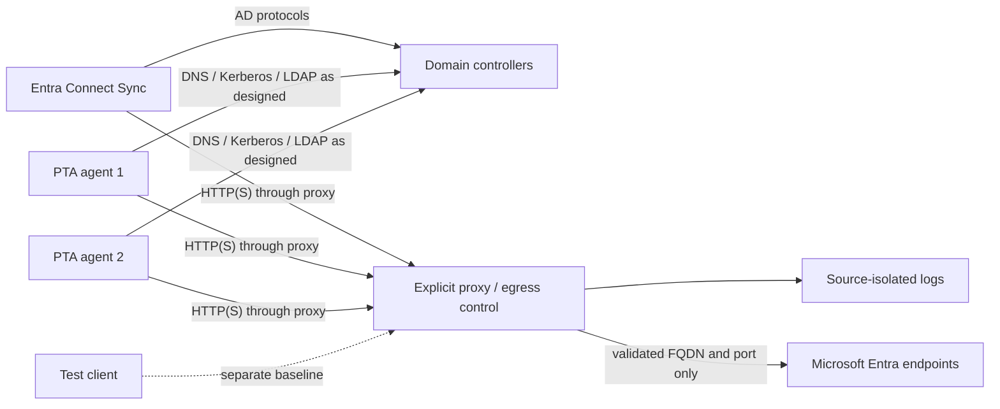

# Microsoft Entra Connect and PTA Egress Validation

<section className="kc-topic-hero kc-topic-hero--compact">
  <div>
    <span className="kc-eyebrow">HYBRID IDENTITY · RESTRICTED EGRESS</span>
    <h2>Prove each dependency before changing the production allowlist</h2>
    <p>Separate Microsoft Entra Connect Sync, Pass-through Authentication and operating-system traffic, then validate observed endpoints with Microsoft documentation and repeatable positive and negative tests.</p>
  </div>
  <div className="kc-hero-metrics" aria-label="Egress validation focus">
    <div>
  <strong>Source</strong>
  <span>Isolate</span>
</div>
    <div>
  <strong>FQDN</strong>
  <span>Classify</span>
</div>
    <div>
  <strong>Test</strong>
  <span>Prove</span>
</div>
    <div>
  <strong>Rule</strong>
  <span>Review</span>
</div>
  </div>
</section>

## Executive Summary

A proxy deny log is evidence that a connection was attempted. It is not, by itself, evidence that the destination is required by Microsoft Entra Connect Sync or Pass-through Authentication (PTA).

In a restricted-egress environment, collect traffic separately for the Connect server, each PTA agent and test clients. Classify every candidate endpoint, verify it against current Microsoft documentation, and prove functional dependency by allowing only that candidate and then blocking it again. This avoids adding browser, Windows, tenant-specific and third-party traffic to a production identity allowlist.

Microsoft currently documents outbound TCP 443 for PTA feature operations and TCP 80 for certificate revocation checks. TCP 8080 is optional for agent status reporting when 443 is unavailable and is not used for user sign-ins. Older Connect or PTA agent versions can require additional ports, so installed versions must be recorded before a firewall decision is made.

---

## 한국어 요약

Squid 같은 Proxy의 deny log는 **통신 시도 근거**일 뿐 AADC 또는 PTA의 필수 허용 URL 목록이 아닙니다. Entra Connect 서버, PTA 서버, Client 트래픽을 분리 수집하고 Microsoft 공식 문서, 호출 process, 기능 실패·복구, 재차단 negative test를 함께 확인해야 합니다.

PTA의 최신 공식 기준은 기능 통신 TCP 443, 인증서 폐기 목록 확인 TCP 80이며, TCP 8080은 443을 사용할 수 없을 때 상태 보고에만 선택적으로 사용됩니다. 구버전 agent는 추가 port가 필요할 수 있으므로 설치 version을 확인하지 않고 일괄 차단하면 안 됩니다. PTA agent와 Microsoft Entra endpoint 사이 outbound TLS에는 inline inspection이나 TLS termination을 적용하지 않습니다.

---

## Scope and Decision Principles

This guide covers:

- Microsoft Entra Connect Sync outbound connectivity
- Microsoft Entra Pass-through Authentication agents
- Microsoft Entra Connect Health where it is installed
- explicit outbound proxy and firewall allowlist validation

It does not convert a lab observation into a universal Microsoft endpoint list. Sovereign clouds, optional Connect features, tenant configuration and agent versions can change the required destinations.

Use these decision rules:

1. Record source IP, hostname, component, agent version, test window and tested function.
2. Rotate or isolate proxy logs before each test.
3. Exclude client, browser and unrelated Windows traffic from the identity-component decision.
4. Treat Microsoft documentation as the baseline, not the final proof for a specific deployment.
5. Require functional recovery and a repeatable negative test before adding an observed-only endpoint.
6. Review rules after agent upgrades and Microsoft documentation changes.

## Reference Architecture



The management plane and direct Internet path should be controlled separately. A lab must prove that the tested servers cannot bypass the proxy through another gateway or network adapter.

## Endpoint Classification

| Classification | Meaning | Production treatment |
|---|---|---|
| Microsoft documented-required | Current Microsoft documentation explicitly requires it for the installed component or feature | Candidate for approval after environment validation |
| Lab-observed and validated | Recovery and negative tests prove a functional dependency | Add with evidence, owner and review date |
| Observed but not validated | Appears in logs but dependency is not proven | Keep blocked or test in isolation |
| OS/security dependency | Windows Update, certificate trust, Defender, NCSI or similar | Govern under the server platform baseline |
| Tenant-specific | Custom domains or tenant services | Validate with the tenant and application owner |
| Third-party/noise | Browser, telemetry, advertising or unrelated software | Exclude from the identity allowlist |

## Microsoft-Documented PTA Baseline

| Destination or purpose | Port | Notes |
|---|---:|---|
| PTA feature communication | TCP 443 | All outbound feature operations |
| Certificate revocation lists | TCP 80 | TLS certificate validation |
| Agent status fallback | TCP 8080 | Optional when 443 is unavailable; not used for sign-ins |
| `*.msappproxy.net` | TCP 443 | PTA cloud communication |
| `*.servicebus.windows.net` | TCP 443 | PTA cloud communication |
| `login.windows.net` and `login.microsoftonline.com` | TCP 443 | Initial agent registration |
| `autologon.microsoftazuread-sso.com` | Through the outbound HTTP proxy | Required when Seamless SSO is used; Microsoft says to list it explicitly |
| Microsoft-documented CRL and OCSP destinations | TCP 80 | Use the current list in the PTA quickstart |

Older versions can require TCP `5671`, `8080`, `9090–9091`, `9350`, `9352` and `10100–10120`. Do not permanently allow or block these ports based only on a generic table. Record the installed Entra Connect, PTA and Connect Health versions, then apply the documentation that matches those versions.

:::warning TLS inspection exception
Avoid inline inspection and TLS termination on outbound TLS traffic between the PTA agent and Microsoft Entra endpoints. Apply the exception narrowly to the documented agent traffic rather than disabling security monitoring broadly.
:::

## Proxy Configuration Boundaries

Microsoft Entra Connect installation and Sync are .NET applications. Microsoft documents the machine-level `.NET Framework` `machine.config` proxy setting for these components. Back up the file, validate its XML, restart the relevant service in a controlled window, and recheck the setting after change management.

The PTA agent runs as a Windows service and can require its own service configuration when WPAD is not available. Do not assume that a user-level browser proxy or WinHTTP setting automatically covers the PTA service context.

Use placeholders in operational documentation:

```xml
<system.net>
  <defaultProxy enabled="true" useDefaultCredentials="true">
    <proxy
      usesystemdefault="true"
      proxyaddress="http://&lt;proxy-fqdn&gt;:&lt;port&gt;"
      bypassonlocal="true"
    />
  </defaultProxy>
</system.net>
```

Never publish real proxy addresses, internal hostnames, tenant domains or credentials in shared runbooks.

## Validation Workflow

| Phase | Action | Required evidence |
|---|---|---|
| 1. Baseline | Block all non-approved egress and prove that no direct path exists | Route, adapter, DNS and firewall test results |
| 2. Isolate | Test one source and one function in a defined window | Source, component, version and timestamps |
| 3. Observe | Collect proxy allow and deny events | Sanitized FQDN, port, method and count |
| 4. Classify | Separate identity, OS, tenant and third-party traffic | Classification and rationale |
| 5. Validate | Allow only one candidate and repeat the failed function | Functional recovery evidence |
| 6. Negative test | Block the candidate again and repeat | Same function fails in the expected way |
| 7. Approve | Add the minimum rule | Owner, approver, expiry or review date |
| 8. Monitor | Recheck after upgrade or feature change | Drift report and updated matrix |

## Production Egress Rule Matrix

The final rule set should contain, at minimum:

| Field | Purpose |
|---|---|
| Source and component | Identifies Connect Sync, PTA or Connect Health |
| FQDN or documented wildcard | Defines the narrow destination scope |
| Protocol and port | Prevents broad any-port rules |
| Phase | Installation, registration, runtime, update or recovery |
| Microsoft evidence | Current official documentation URL and review date |
| Observed evidence | Sanitized proxy event and test window |
| Dependency result | Recovery and negative-test outcome |
| TLS inspection policy | Explicit exception where Microsoft requires it |
| Owner and review date | Supports lifecycle management |

## Common Failure Modes

- Mixing client and server traffic, then treating every domain as an identity dependency
- Allowing a domain because it appeared frequently in deny logs
- Using expiring screenshot links as operational evidence


## Microsoft References

- [Microsoft Entra pass-through authentication quickstart](https://learn.microsoft.com/en-us/entra/identity/hybrid/connect/how-to-connect-pta-quick-start)
- [Microsoft Entra Connect prerequisites](https://learn.microsoft.com/en-us/entra/identity/hybrid/connect/how-to-connect-install-prerequisites)
